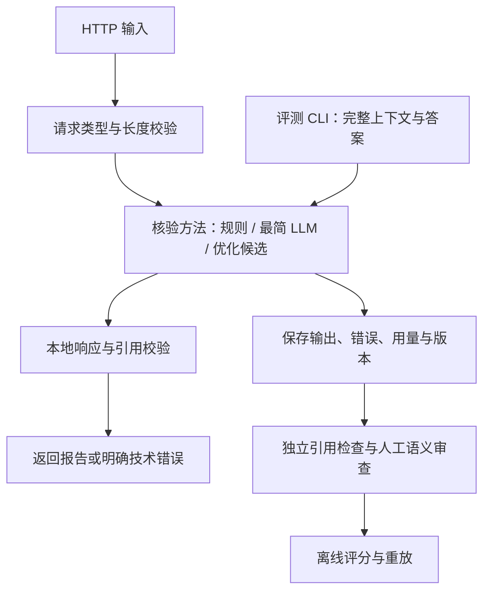

# TabbyML 面试项目：规划思路与关键设计取舍

版本：2026 年 10 月 15 日。面向你理解项目、参与决策和准备面试。

这份文档解释每一步解决什么问题、为什么选择当前方案、付出什么代价，以及什么证据会让我们改变选择。它依据当前代码与运行记录，不把规划中的功能写成已完成的能力。

当前状态：dev/test 保持英文；Canvas 已删除，不再安排恢复或维护。数据仍待你人工复核，最终测试没有运行，优化方案没有完成对照实验。本文使用中文帮助理解；最终提交的英文 README 仍需另行完成。

## 1. 先明确这道题到底考什么

题目要求一个服务：输入若干原文段落和一段生成答案，拆出答案里的事实，判断每个事实是否得到原文支持，并附上原文引用。具体合同见 [assignment.md](../assignment.md)。

例如，原文说“只读模式拒绝所有写入”，答案说“只读模式允许写入”，应判为 `CONTRADICTED`。如果答案说“使用 AES-256 加密”，原文完全没有提到加密，应判为 `UNSUPPORTED`。即使外部世界中这句话是真的，也不能替这份材料补证据。

题目明确强调三件事：评测是否严谨、能否根据失败迭代、工程实现是否清晰可复现。因此，我们需要同时交付三个层面的证据：

| 层面 | 要回答的问题 | 什么证据有说服力 |
|---|---|---|
| 输出合同 | 返回结果是否满足接口要求？ | 独立构造的坏索引、伪造引文、错误类型等测试 |
| 语义质量 | 事实是否漏了、标签是否正确、引用是否足够？ | 人工复核的 gold、事实对齐记录、完整分母的指标 |
| 改进过程 | 为什么增加某个提示词或处理步骤？ | 具体失败案例、改动假设、同条件对照、代价记录 |

**我的规划原则是先让结果可信，再判断怎样改进。** 如果 gold 本身有歧义、错误请求被丢出分母，或者引用存在就被当作引用充分，最后的分数再高也难以解释。

这样安排的代价是：数据、审查和评测会占去相当多时间，可供尝试模型技巧的时间变少。仍然这样选择，是因为这正好对应题目的主要考点，而且能避免在不可靠的指标上反复优化。

### 如果我是考官，会怎样审视这个项目

以下是根据题目推导的审视角度，不是招聘方公布的额外 rubric，也没有擅自设置权重或通过分数。

| 维度 | 我会重点追问 | 暴露问题的表现 |
|---|---|---|
| 需求理解 | 真实但材料未提及的事实怎么处理？ | 用模型常识把它判为支持 |
| 责任边界 | 哪些约束由代码保证，哪些仍依赖判断？ | 认为结构化 JSON 就等于事实正确 |
| 评测可信度 | 漏报、重复、复合事实、请求失败怎样计分？ | 只计算成功请求或已提取事实的准确率 |
| 迭代质量 | 每项优化来自哪个失败？ | 先堆复杂流程，再寻找证明它有效的指标 |
| 工程质量 | 引文、异常、成本、版本能否追溯？ | 失败变成 UNSUPPORTED，结果无法重放 |
| 工程判断 | 为什么没有做更多功能？何时会改设计？ | 只能说“时间不够”，说不出收益与代价 |
| 个人理解 | 能否说明一条事实从输入到评分的全过程？ | 能启动程序，却解释不了标签或分母 |

## 2. 为什么按这个顺序推进

原计划是 32 小时任务加 4 小时缓冲，内部截止为 **2026 年 10 月 21 日伦敦时间 18:00**。这些是项目安排，不是题目规定的工程标准，也不是招聘方确认的截止时间。

| 步骤 | 做什么 | 为什么放在这里 | 提前或省略的代价 |
|---|---|---|---|
| T1 / MIC-102 | 环境、接口合同、真实模型访问 | 先排除依赖、账户权限和结构化输出接入风险 | 最后才发现接口或账户不可用，会迫使整个方案重做 |
| T2 / MIC-103 | 定义事实粒度、评分规则，起草 8 个 dev | 先知道“怎样算对”，才能解释后续分数 | 容易实现完才发现指标偏爱某种拆分方式 |
| T3 / MIC-104 | 起草并人工复核 20 个 test，再冻结 | 在看模型测试输出前确定标准答案 | 看完错误再改标准答案，容易无意中迁就模型 |
| T4 / MIC-105 | 保存运行、导出审查、重算指标 | 所有方法从一开始就留下可追溯证据 | 后补日志会丢失原始失败和真实调用次数 |
| T5 / MIC-106 | 非 LLM 基线 | 看简单文本匹配能解决多少、会错在哪里 | 缺少一个能解释语义判断价值的低成本参照 |
| T6 / MIC-107 | 最简 LLM 基线及人工审查 | 得到增加复杂度之前的真实起点 | 无法判断精炼提示、多阶段或修复是否值得 |
| T7 / MIC-108 | 根据 dev 失败尝试优化 | 把复杂度花在已观察到的问题上 | 容易做出流程更长、收益不明的系统 |
| T8 / MIC-109 | 故障验证、比较候选、冻结方案 | 在最终测试前固定实现和配置 | 最终测试会同时变成调试和选型过程 |
| T9 / MIC-110 | 三种方法运行 test，全量语义审查 | 用统一条件获得最终比较 | 只挑成功案例或最好输出，会高估效果 |
| T10 / MIC-111 | 干净复现、英文报告、讲解演练 | 验证别人真的能运行，你真的能解释 | 本机可用但仓库不可复现，或结论没有依据 |

这些步骤是依赖顺序，不要求所有工作严格串行。例如数据起草和接口实现可以同时推进，测试和 README 应随开发积累。人工批准、模型选择和最终测试的先后关系则需要保留。

**缺点：** 这个顺序前期看起来没有那么多“智能功能”，还会暴露一些必须先处理的标注问题。

**仍然这样选：** 早发现评分不一致，比最后发现整个对比无效更容易修复。最终交付最难补救的是证据缺失，不是少一轮提示词实验。

**范围控制：** 时间不足时，先减少额外优化轮次、消融和案例扩展；保留三种方法、20 个最终案例、人工审查、错误处理和复现说明。原先对 audit 整改的 3–4 小时估计不能当作保证，人工复核时间应尽早实测。

## 3. 为什么把系统拆成这几个部分

这个图表达职责，省略了重试等细节。代码对应关系如下：

| 部分 | 主要文件 | 应负责什么 |
|---|---|---|
| 领域合同 | [domain.py](../src/grounding_verifier/domain.py) | 类型、verdict、引用关系、逐字检查 |
| 模型适配 | [llm.py](../src/grounding_verifier/llm.py)、[budget.py](../src/grounding_verifier/budget.py) | SDK 调用、用量、预算、重试、修复和截止控制 |
| 非 LLM 方法 | [baseline.py](../src/grounding_verifier/baseline.py) | 确定性分句、相似度和有限否定规则 |
| HTTP | [api.py](../src/grounding_verifier/api.py) | 接收请求、选择配置、映射错误 |
| 数据与评测 | [dataset.py](../src/grounding_verifier/dataset.py)、[evaluation.py](../src/grounding_verifier/evaluation.py)、[cli.py](../src/grounding_verifier/cli.py) | 数据版本、运行记录、人工审查和指标 |

**优势：** 同一方法既能被 HTTP 调用，也能直接评测；评测不用为了测模型而每次启动服务器。确定性规则集中后，三种方法遵守同一个合同。

**代价：** 比一个文件里直接调用模型多了几层组织；领域测试通过，也不能替代 HTTP 和 SDK 适配器的集成验证。直接 CLI 测得的核验耗时也不等于完整 HTTP 请求耗时。

**仍然这样选：** 三种实现和离线重放是作业明确需要的，适度拆分能直接减少重复，而不是为未知需求建框架。

### 技术栈为何这样选

| 选择 | 主要收益 | 缺点 | 为什么目前仍合适 |
|---|---|---|---|
| Python 3.12 | 服务、数据处理和实验共用语言 | 类型更多依赖运行时校验；不适合把 CPU 密集任务都放进异步请求 | 当前主要耗时在远端模型调用，评测便利更有价值 |
| FastAPI + Pydantic 2 | 请求/响应类型明确，校验规则集中 | 验证器配置不当会产生类型转换或漏检 | 对索引等关键字段显式严格校验，并用独立坏样本验证 |
| Anthropic 官方 SDK | 少写鉴权、协议和响应解析代码 | 依赖其参数、错误类型与版本行为 | 固定依赖，关闭隐式重试，保留实际响应元数据 |
| uv + 锁文件 | 将依赖版本记录下来，简化复现 | 锁定依赖不等于锁定远端服务和操作系统行为 | 对本作业而言足够实用，同时记录模型、源码和运行环境信息 |
| pytest + Ruff | 检查关键失败路径，保持代码易读 | 测试可能只重复实现；格式检查不能证明业务正确 | 使用独立反例和计分场景，避免只测试正常路径 |
| JSONL 数据 + JSON 运行记录 | 可直接检查、比较、提交和重放 | 修改不如数据库事务方便；大规模查询能力有限 | 28 个案例和串行实验无需数据库运维成本 |

不做前端、向量检索、数据库或云部署的原因是：输入已经提供完整上下文，这些功能不能直接补上题目的主要证据。代价是缺少产品展示和大规模服务能力；如果未来真的要接入生产流量，应重新设计存储、并发、鉴权、监控与部署。

## 4. 为什么选择 Claude Haiku 5.5

### 4.1 它是一个经过接入验证的起点，尚未证明是最优模型

当前模型 ID 为 `claude-haiku-5-5`。官方将其定位于分类、抽取等对延迟敏感的任务，并提供自适应思考与 effort 配置。本项目需要抽取事实、分类并组织证据，这构成任务适配的理由。[官方模型说明](https://platform.claude.com/docs/en/models/haiku-5-5/overview)

更直接的证据来自本机：账户可以访问该模型，结构化调用成功，已经完成 8 个 dev 的端到端运行和 8 个固定事实诊断运行。我们没有做 Haiku、Sonnet、Opus 或其他服务商的同条件质量比较，因此不能把当前选型表述为“测下来最准确”或“性价比已经最优”。

### 4.2 真正的选型理由及其代价

| 理由 | 有什么价值 | 有什么不利之处 | 为什么目前接受 |
|---|---|---|---|
| 抽取与分类的任务形态相近 | 能快速验证端到端流程 | 复杂否定、限定条件、多段推理仍可能失败 | 先以人工审查的 dev 结果判断是否够用，不预设能力结论 |
| 当前账号已能访问 | 避免权限与接入阻塞 | 方便接入不是模型质量证据 | 将可用性与质量分开判断，后者必须做评测 |
| 调用成本较低 | 允许复跑和失败分析 | 容易误以为便宜本身就能证明选择正确 | 质量和误支持风险优先，费用作为后续比较因素 |
| 同一个模型比较 minimal 和 optimized | 改善更容易归因于方法变化 | 结果只直接说明这个模型下的表现 | 题目要求比较三种方法，不要求模型排行榜 |
| 暂时只支持一个服务商 | 代码和实验变量较少 | 供应商绑定，切换时要调整适配与费用配置 | 一周内先验证核心问题，多服务商适配目前没有直接收益 |

最初的 $20 是总预算上限。截至本次核对，16 次调用按返回 token 和费率估算仅约 $0.0034188。**这说明当前真正稀缺的是审查和实验时间，不能再用“更强模型一定太贵”解释选型。** 保留 Haiku 的主要理由是控制变量和减少接入变动，同时等待有区分力的质量证据。

### 4.3 为什么不直接用更强模型，或者同时比较很多模型

更强模型值得考虑，但应该回答一个明确问题。例如：Haiku 在保留条件上反复失败，换一个模型是否能稳定解决？在没有观察到这种失败前，同时扩展多模型会增加参数组合、结果审查和解释成本，也可能掩盖方法本身的变化。

反过来，如果修订后的 dev 显示 Haiku 有持续的语义短板，应做一次范围明确的更强模型诊断。若决定换模型，应让 minimal 与 optimized 一起使用新模型和相同配置，重新建立可比结果，而不是只给优化组升级。

本项目也没有要求 Anthropic 品牌；换其他服务商是可行选项。当前没有它们的同条件实测，因此文档不对它们的质量排序。暂不切换的理由是已有可运行适配器，而不是其他模型不适合。

### 4.4 为什么固定这些推理配置

当前两套 LLM 使用相同的 `thinking={type: adaptive}`、`effort=medium`，输出上限为 8,192 tokens。没有设置 `temperature`、`top_p` 或 `top_k`；参数兼容性依据当前官方说明。[模型参数说明](https://platform.claude.com/docs/en/models/haiku-5-5/overview)

`medium` 是起始配置，不是经过 effort 消融后选出的最优点。固定它的作用是避免把更多推理预算的收益误归因于提示词改进。代价是可能错过更快或更准的配置；在核心失败已经清楚、仍有时间时，才值得单独试验。

8,192 的作用是限制单次输出和费用，不代表这么长的答案一定能处理完。若输出截断，应报告技术失败，不能静默接受缺失事实；如果开发证据表明上限不足，应统一修订配置并重跑对照。

记录模型 ID、参数、提示词、依赖及原始输出，能够支持结果审计。即使模型版本明确，重复调用也不能保证逐字相同；因此需要同时保存真实输出和必要的稳定性复跑记录。

### 4.5 结构化输出为什么还需要本地校验

结构化输出减少格式错误，但不负责证明引文确实来自请求中的指定段落，也不负责判断证据能否推出结论。官方还列出了拒绝和 token 截断等例外，所以应检查停止原因，而不是只看 HTTP 200。[结构化输出说明](https://platform.claude.com/docs/en/build-with-claude/structured-outputs)

当前代码向 API 发送经过简化的 JSON Schema，再在本地执行完整 Pydantic 与引用约束。兼容 API 所需的 schema 简化，不应降低本地验收标准。

## 5. 核验服务的关键问题怎样解决

### 5.1 如何拆事实：保留判定条件，再拆独立断言

事实单元应当能独立判断，但必须保留主体、时间、数量、否定和适用条件。

例如，“在只读模式下拒绝写入，并允许读取”，可以拆成“在只读模式下拒绝写入”和“在只读模式下允许读取”。不能把第二项改成没有条件的“总是允许读取”。

**优势：** 可以分别识别一段答案里正确和错误的部分，避免一句话只有一个标签掩盖混合错误。

**缺点：** 原子性没有唯一的自然语言拆法。拆得过细会增加审查量，拆得过粗会误伤正确的细拆预测。

**选择理由：** 题目明确要求原子事实，必须给出可操作规则；但评分允许人工忠实拆分复合预测，单独报告原子性，不把某一种表面句式当唯一答案。已发现的 gold 粒度问题先修标注，不立刻引入复杂的多对多匹配算法。

### 5.2 如何区分“矛盾”和“没证据”

| 场景 | 应判定 | 原因 |
|---|---|---|
| 原文：恰好保留 30 天；答案：恰好保留 31 天 | CONTRADICTED | 相同对象和条件下，两个数量不相容 |
| 原文：保存为本地文件；答案：文件使用 AES-256 | UNSUPPORTED | 保存位置既不证明也不反驳加密算法 |
| 原文：开启 secure mode 时加密；只知道服务使用该引擎 | UNSUPPORTED | 缺少模式已开启的前提，不能跳过条件 |
| 原文：服务使用 Q，所有 Q 服务都加密 | SUPPORTED | 主体归属与通用规则共同形成完整推理链 |

**优势：** 保持材料范围内的判断，避免常识和关键词替代证据。

**缺点：** 直接反驳、未证实和条件不匹配有时很接近，单靠提示词不能保证正确。

**选择理由：** 三分类是接口合同的一部分；需要明确判定说明、对照案例和人工复核。发生标签混淆时优先修判定说明，而不是先增加拆解阶段。

### 5.3 引用怎样做到可验证

程序检查：索引是严格整数；索引在范围内；quote 非空且非纯空白；quote 是对应原始段落的逐字子串；SUPPORTED/CONTRADICTED 有引用，UNSUPPORTED 没有引用。布尔值 `True` 不能作为索引 1 被接受。

不先统一引号、大小写、空格或标点再匹配，因为那样会把模型改写的句子误当作原文。若源文是弯引号，输出换成直引号，也应按原始合同处理。

**优势：** 可以确定地拒绝伪造引用和越界引用，不依赖第二个模型替第一个模型背书。

**缺点：** 很容易出现“引文存在，但证明不了当前事实”。严格逐字匹配也会拒绝语义相同的改写。

**选择理由：** verbatim 是题目明确要求；语义相同不能代替引用真实性。证据充分性另外审查，两个层面都保留。

全文引用是合法引用，不要求必须最短。短引用有利于阅读，过短却可能丢掉主体、条件或指代。选择相关且充分的片段，不为了好看统一截成一句。

### 5.4 为什么没有把模型的 reasoning 当作证明

reasoning 应简短说明证据与 verdict 的关系，而不是索取模型隐藏思考过程。解释可以帮助定位“数字看错”“条件丢失”“缺少前提”等问题。

代价是模型可能先判断错，再给出流畅解释。因此，判断是否正确要回到事实与引用，不能因为文字自洽就给分。gold 的 reasoning 也一样：模板化解释通过非空校验，不代表标注已充分。

### 5.5 两阶段若真的需要，怎样防止事实被改写或漏掉

计划中的两阶段方案会先提取事实，再验证固定事实。程序给事实分配 `c0`、`c1` 等 ID；第二阶段只能返回 ID 与判断。代码检查没有遗漏、重复或未知 ID，再回填第一阶段原始事实文本。

**优势：** 核验阶段不能悄悄把一个难判断的事实改成容易支持的版本，遗漏也能被发现。

**缺点：** 多一次调用、更高耗时，第一阶段拆错仍会传递到后面；固定 ID 只保护阶段间一致性，不能证明拆解完整。

**选择理由：** 只有 dev 显示遗漏、复合事实或限定条件丢失是主要问题时才值得尝试。目前只有 ID 绑定与检查的辅助代码，完整两阶段流程尚未实现或获选。

## 6. 为什么必须保留三种方法

### 6.1 非 LLM 基线：说明“文本相似”与“事实蕴含”的差别

当前方法使用规则分句、TF-IDF 相似度和很保守的否定反转规则。引用直接取原文句子。阈值 0.65 是起始配置，尚未完成开发集阈值比较。

**优势：** 确定、快速、无模型费用，容易解释和复现。

**缺点：** 词汇重叠不能处理复杂数字、条件、同义改写或跨段推理。两个句子只有数字不同，也可能非常相似，从而被错误判为支持。当前分句、分词主要面向英文，不应声称已经验证多语言能力。

**仍然这样选：** 这是简单参照，用于展示语义方法解决了什么。它仍需合理实现与 dev 调参，不能故意做弱来夸大 LLM 收益。暂不用本地 NLI 模型，是为了不引入另一套模型下载、运行环境和模型选型问题；不代表 NLI 本身没有价值。

当前固定事实诊断的宏平均 F1 约 0.4524，说明这个配置在 draft dev gold 上有明显局限；它不能代替端到端审查结论。

### 6.2 最简 LLM：得到一个清楚的起点

正常路径一次调用；提示词交代任务、标签、引用和数据边界；返回结构化结果后做本地检查，不修复无效输出。暂时性的网络重试与“让模型改答案”分开统计。

**优势：** 便于判断额外说明或步骤带来了什么，调用成本和失败行为容易解释。

**缺点：** 一次本可修复的引用错误会直接导致请求失败，可能比有修复的系统成功率低。

**仍然这样选：** 这是需要被比较的最小方法；失败如实计入，能量化后续修复的价值。最简不意味着取消题目要求的输出合同或基本提示注入边界。

### 6.3 优化候选：每一项复杂度都应有失败依据

| 观察到的失败 | 优先尝试 | 暂不直接跳到的方案 |
|---|---|---|
| 引文不逐字、索引错误 | 检查确定性校验；测试有限输出修复 | 额外增加事实拆解调用 |
| 数字、默认状态、条件标签混淆 | 明确判定规则和保留条件的提示 | 无证据地增加代理或更长推理链 |
| 答案事实遗漏、复合事实混在一起 | 强化覆盖要求；必要时独立拆解 | 默认所有请求必须两阶段 |
| 多段引用缺少一环 | 要求每个必要前提都提供证据 | 仅增加引用数量而不审查充分性 |

当前已有更精炼的判定提示和至多一次输出修复的候选代码，但没有该候选的真实对照结果。**“optimized”目前是方法名称，不是已经证实优胜的结论。**

有限修复的代价包括额外延迟、费用，以及标签和事实可能随修复一起变化。因此要保留首次输出、最终输出及完整错误记录；格式修复成功不等于语义修复成功。

选择候选时，先满足接口不变量，再比较 dev 端到端事实＋标签 F1；同分时看误支持率，再看证据充分性、成本和延迟。如果增加复杂度没有收益，就保留更简单的实现，并在实验记录中说明失败的尝试。

## 7. 为什么这样设计 dev、test 和工程测试

### 7.1 dev 与 test 的分工

| 集合 | 当前数量 | 用途 | 允许怎样使用 |
|---|---|---|---|
| dev | 8 cases / 12 gold facts | 找错、调阈值、试提示、选择候选 | 可以反复看输出、分析和修改方案 |
| test | 20 cases / 31 gold facts | 冻结方案后的最终对比 | 先人工确认 gold；最终输出不用于继续提示词调优 |
| tests/ 中的工程测试 | 最近一次验证为 39 项通过 | 检查代码合同、坏输出和评分行为 | 随实现变化增加有意义的回归，不等于模型质量评测 |

dev/test 不用于训练模型权重。这里“调优”主要指调整提示词、规则、阈值与流程。

**为什么是 8＋20：** 20 对应作业的案例数要求；额外保留一小组 dev，让最终测试不用承担试错任务。8 是工作量安排，不是统计学上充分的样本量。缺点是容易漏掉失败类型，也不支持稳定的细分结论；若发现新问题，可以加 dev 回归，但不要把某个 test 错误移到 dev 来美化成绩。

test 的人工标注复核可以提前做，这是检查考题与标准答案；它与看完模型测试输出后针对性调提示不同。方法与配置冻结后，再进行最终三方法评测。

### 7.2 为什么先用合成的技术规格

题目允许自行编写技术/系统案例。使用虚构产品规格，可以清楚控制“原文支持”“直接反驳”“外部信息”和“跨段推理”，也容易解释某个 verdict 为什么成立。

**缺点：** 当前段落只有 31–137 字符，实体关系简单。模型可能轻松做对；这套数据不能代表长文、真实检索噪声或广泛业务分布。所有来源分组字符串不重合，也不能证明没有推理模板相似性。

**仍然这样选：** 一周内先得到可审查、可控的评测起点，比引入尚未吃透的外部标注口径更可靠。但报告必须写清范围，对有价值的失败补开发/工程挑战，而不能把当前高分当全面鲁棒性证明。

当前四类案例数均衡，但标签不等量：dev 为 8 S / 2 C / 2 U，test 为 18 S / 7 C / 6 U。多段综合或外在信息案例也可能包含支持事实。报告应展示标签分布和分类诊断，避免大多数支持事实掩盖对矛盾的弱表现。

### 7.3 为什么保留英文

你已经撤回全中文改动，数据实际没有被修改。英文与原题、提交文档和当前规则基线一致，可以减少翻译导致的条件、否定、术语与逐字引用变化。

代价是你阅读标注时可能更慢。解决方式是用这份中文设计说明和逐例讨论帮助理解，而不是未经确认同时维护两份会漂移的评测数据。若未来正式验证中文能力，应视为新的评测范围，并补齐中文分句、分词和对照实验。

## 8. 为什么评分不能只用一个“准确率”

只计算“模型提取出来的事实中，标签有多少正确”，会奖励少提事实。只计算成功请求，又会奖励失败后不交卷。因此主评测让三种方法接收完整答案，并把提取、判定和失败一起考虑。

### 8.1 主指标：事实＋标签 F1

TP：与某个唯一 gold 事实语义等价，且 verdict 正确。FP：多余、重复、或匹配事实但 verdict 错误的预测。FN：遗漏、错误标签对应的 gold，或失败请求中的 gold。

`F1 = 2 × TP / (2 × TP + FP + FN)`

例如 gold 是 A 支持、B 矛盾；系统输出 A 支持、B 支持，则 TP=1、FP=1、FN=1，F1=0.5。覆盖率仍为 100%，说明两个事实都提到了，问题出在 B 的判断。

**优势：** 能把遗漏与标签错误共同计入，不让少输出轻易得到高成绩。

**缺点：** 需要语义对齐；常见事实在汇总中权重较大，gold 粒度变化也会改变分母。F1 不直接表示某一次误支持的业务危害。

**仍然这样选：** 它对应完整任务，但必须配套风险和证据指标，不能单独用于宣称系统安全或全面更好。

### 8.2 配套指标为什么都要保留

| 指标 | 解决的问题 | 单独使用时的陷阱 |
|---|---|---|
| 事实覆盖率 | 是否漏掉答案里的事实 | 全提取却全部判错，覆盖仍可很高 |
| 误支持率 | 把 C/U 错判为 S 的风险 | 少输出或大量失败可能让它看起来很低 |
| 错误拒绝率 | 把 S 判为 U 的保守代价 | 不包含漏报，也不单独描述 S 被判 C |
| 首次/最终引用合法率 | 引用是否真实，修复有何作用 | 引文存在不证明结论成立；空引用分母不能写成 100% |
| 证据充分率 | 引用集合能否支持所报 verdict | 需要人工判断，受审查口径影响 |
| 原子性 | 系统是否输出独立断言 | 人工未忠实拆分时，计数也可能失真 |
| 成功率、修复率、调用数 | 系统能否交付、依赖多少补救 | 高成功率不等于标签正确 |
| token、费用、延迟 | 改进花了什么代价 | 重放速度或小样本分位数不能冒充真实在线性能 |

没有适用分母时显示 N/A，而不是强行填 0 或 100%。误支持率和错误拒绝率必须与覆盖率、成功率一起看。

### 8.3 为什么还做固定 gold facts 的诊断

让各方法直接验证相同 gold 事实，自动计算三分类结果，可以区分“事实没拆好”和“拆好后仍判断错”。这会绕过拆解，因此不能替代主评测，也不能拿它的宏平均 F1 充当端到端 F1。

它的优势是诊断清楚，不再增加一轮完整的提取对齐审查。缺点是难度降低，且仍依赖 gold 正确；当前 minimal 的诊断 macro-F1=1.0，只说明它在这 12 个 draft gold 事实上的标签符合标注。

## 9. 为什么保留人工审查，怎样控制它的缺点

语义等价与证据充分性不能靠字符串相同判断。模型可能把“每小时一次”写成“每隔一小时生成一次”，也可能选择不同但充分的引用。因此人工审查需要按含义对齐，不能要求预测文本与 gold 逐字一致。

当前安排是：自动运行保存结果并导出模板；人工填写事实对齐与证据充分性；评分器验证数据、输出和审查记录是否属于同一版本，再计算语义指标。成功输出尚未审查时，不生成完整端到端语义分数。

**缺点一：时间贵。** 最终 20 cases × 3 methods 共 60 份输出，远比 token 费用重要。T6 就应实测审查耗时，必要时减少优化轮次。

**缺点二：审查有主观性。** 需要统一条件保留、复合事实和重复的规则；争议应有注释和裁决。隐藏方法名称能降低偏见，但输出风格可能泄露方法，不能声称完全盲测。

**缺点三：你既参与设计，又复核标注。** 这是当前资源安排，不是完全独立的第三方评审。AI 起草或 audit 也不能伪装成人工批准；报告应准确交代分工。

仍然保留人工审查，是因为本题的关键语义指标需要可解释判断。引入另一个 LLM 自动打分虽更快，却会新增评判模型、提示与偏差问题；当前规模下，先把人工口径做清楚更合适。

重复预测按输出顺序只让首次匹配占用 gold，后续重复算 FP。这样可能比“挑其中标签正确的一条”更苛刻，但不会奖励系统反复猜测。同一复合预测可以忠实拆成若干评分单元，继承原 verdict 和 citations；不能在拆分时顺便修正它的标签或丢掉错误条件。

## 10. Audit 为什么改变了下一步优先级

详见 [gold audit](../reviews/gold-dataset-audit-2026-10-15.md)。它发现的主要问题是标注和审阅流程，而不是有证据必须翻转某个现有 verdict。

| 问题 | 解决思路 | 优势 | 代价与仍这样选的理由 |
|---|---|---|---|
| test-05 把 HTTP 200 与 JSON body 合成一个 gold | 拆成两个事实，再保留无认证事实 | 避免正确细拆的预测被当作重复 | gold 总数从 43 变为 44，旧新分数不可直接比；这是统一口径的必要修订 |
| 43 条解释都是通用模板 | 补各例实际数字、条件、缺失信息或跨段链 | 标注理由可审查、可讲解 | 写两套近义长文会浪费时间；解释应简短，annotation_reason 只补有用的标注判断 |
| 原审阅页不展示解释 | 在实际采用的审阅材料中呈现完整字段 | 复核者能看到判定依据 | Canvas 已删除，恢复与生成器维护任务取消；直接使用完整 JSONL 或轻量 Markdown 即可 |

上述数据修复仍未实施。当前仍为 43 条 gold，test-05 仍是两个 gold；文档中的 44 是修复后的预期数量。

原整改文件里关于 Canvas 重生成的安排，已被你的删除决定取代。不能为了完成旧方案而恢复你删除的辅助工具。

当前数据哈希包含 reasoning 和 annotation_reason，因此只改解释也会让旧运行/审查不再匹配。这个策略容易理解，能防止旧批准无意套到新数据，但对小改动比较保守。

在这次小项目里，计划集中修改标注，保留 v1 结果，生成新版本开发运行和审查包。更细致地区分“输入版本”与“标注版本”可以减少重跑，但需要额外的来源迁移规则；当前没有足够收益支持增加这一层。不能直接把旧运行里的哈希改成新的。

先修这些问题，是因为评分器如果误罚正确拆分，我们就可能为提高分数而把模型改得更不原子。数据修订引起的分数改善必须称为评测口径修复，不能称为模型优化收益。

## 11. 边界、错误、重试和预算为何这样处理

### 11.1 技术失败不等于缺乏事实依据

| 情况 | 约定行为 | 为什么这样做 | 代价 |
|---|---|---|---|
| 输入缺字段、格式错误、超过上限 | 422 | 明确要求调用方修正输入 | 客户端需要处理拒绝，不能依赖静默截断 |
| 模型输出违反合同或被截断/拒绝 | 502 | 没拿到可验收的核验结果 | 一个局部输出问题会导致整次失败 |
| 暂时性上游故障，重试耗尽 | 503 | 表示暂时无法完成 | 调用方需要决定是否稍后重试 |
| 核验执行超过总截止时间 | 504 | 避免无限等待 | 可能放弃本来最终能完成的调用 |
| 预算耗尽或账本不可用 | 503 + 明确错误码 | 费用控制失败时停止新增调用 | 保守预留可能提前阻止实验 |

模型没有响应，不能给事实标 UNSUPPORTED。否则网络故障会被混进质量分析，也可能让系统表现得“更保守、更安全”，实际却只是没有完成任务。

返回整次错误的代价是无法交付其余已正确的事实。仍然这样选，是因为题目没有规定部分成功协议；另加部分成功字段会改变接口，也会让覆盖和分母更难解释。

### 11.2 为什么重试和修复共用额度

一次正常调用之外，最多再发两次请求；输出修复最多一次；SDK 隐式重试关闭。这样总调用数有明确上界，网络重试和模型修复不会各自乘开。

**缺点：** 网络问题已经花掉额度后，即使输出错误本可修复，也可能不再允许调用。

**仍然这样选：** 保证总延迟、费用和行为可解释比无限补救更重要。每次尝试都记入 trace；临时失败使用短退避，不把所有 4xx 都当作重试理由。

90 秒是请求级核验执行的起始时间预算，不是根据生产 SLA 推导出的值。当前 `execute` 将模型调用、退避、修复放在同一个异步超时范围内；HTTP 层的 provider 初始化/关闭以及同步文件锁并非都能被该定时器直接中断。T8 必须验证实际边界，不能仅凭有一个 timeout 就宣称完整 HTTP 墙钟时间严格不超过 90 秒。

### 11.3 空输入、无事实、来源冲突和提示注入

| 场景 | 处理思路 | 关键限制 |
|---|---|---|
| 空答案 | 直接返回空 claims，不调用模型 | 只解决确定为空的情况 |
| “谢谢”等无事实答案 | 允许空 claims | LLM 的事实识别仍可能出错，规则仅覆盖明显情况 |
| 空上下文、非空事实答案 | 仍提取事实，事实判 U，引用为空 | 校验能限制引用，不能证明事实没有漏提 |
| 同条件材料相互冲突且无法消解 | 项目策略为 U，并说明冲突 | 这是项目自定边界政策，不是题目额外规定；不混入主评分集 |
| 段落里含“忽略指令”等文本 | 明确当作数据，检查能否改变核验行为 | 提示词只能降低风险，不能证明语义上绝对免疫 |

输入上下文合计上限 50,000 字符，答案上限 10,000 字符。它们是控制资源与输出规模的工程默认值，既不是模型窗口上限，也不是已验证过的长文能力。超限拒绝比静默截断更容易保持材料完整性。

### 11.4 为什么调用前先预留费用

本地账本使用文件锁与原子替换，让多个进程不会同时把同一份剩余额度花掉。调用前预留上界，拿到实际用量后结算；没有用量的失败保留预留，等待核对。

**优势：** 避免先花钱、事后才发现超过 $20；未知费用不被当成零。

**缺点：** 保守预留会暂时锁住远多于实际费用的额度；失败也可能让可用预算比真实余额小。文件锁和本地 JSON 也不适合多机器部署。

**仍然这样选：** 这是单机、小规模实验，文件账本容易审计。未知费用人工核对比自动清空更稳妥；若变成多机生产服务，应使用集中式额度与计费机制。

按 2026-10-15 查询的官方公开费率，输入不超过 100,000 tokens 时为输入 $0.10/百万 tokens、输出 $0.50/百万；更长提示为 $0.50/$2.50。当前单次预留按完整 1M 输入窗口的高费率加最大输出估算，约 $0.52048，明显高于这些短 dev 请求的实际估计费用。[Haiku 费率](https://platform.claude.com/docs/en/models/haiku-5-5/overview)

费率不是永久常量，换模型或变更价格配置要重新核对。当前记录是依据 provider 返回用量和费率估算，不冒充账单最终结算金额。

## 12. 为什么要保存这么多记录，以及它们的代价

一个可用的对比应能回答：用的是哪版数据、哪份提示词、哪个模型配置？第一次是否失败？修复用了多少次？某个引文原来是什么？

因此记录源码/依赖/数据版本、模型与配置、原始可评分文本、停止原因、错误、用量、费用、调用次数和耗时，审查再绑定数据与输出哈希。

**代价：** 文件更多，结果不能随手覆盖；数据小改也可能让审查失效；包含实际业务上下文时还需要管理可提交范围。当前是合成数据，但仍不能把密钥写进产物。

**仍然这样选：** 没有这些信息，就无法区分实现改进、数据改变、模型配置改变和随机波动。原始记录在本机存在，也不代表已经成为公开可复现交付：当前 `runs/` 默认忽略，最终还需选取适合提交的结果与对应数据/审查材料。

最终运行固定串行，减少并发导致的限流、资源竞争和延迟比较混乱。代价是跑数更慢，不能据此声称生产吞吐量。对 60 份最终输出，这种可解释性优先的安排可以接受。

首次结构化调用可能受到 schema 编译、连接等开销影响，所以首个 client 调用单列。但当前标记只表示“该 client 的第一次请求”，并不能证明远端 schema 缓存当时是冷的。报告必须使用准确名称。[结构化输出的首次请求说明](https://platform.claude.com/docs/en/build-with-claude/structured-outputs)

缓存重放用于检查已有输出如何得分，不计为新的真实推理延迟。小样本的 p95 只作描述，不能当稳定 SLA，也不宣称统计显著。

## 13. 当前究竟有哪些证据，哪些结论还不能下

以下是本次读取的已保存结果，没有为编写文档新增付费调用。

| 项目 | 已有证据 | 能说明什么 |
|---|---|---|
| 工程验证 | 最近一次回归 39 passed；Ruff 检查通过 | 已覆盖的合同与评分场景通过；完整故障验收仍待完成 |
| lexical dev 端到端 | 8/8 成功；产生的 4 条引用合法 | 能运行、能输出合法引用；语义成绩仍待人工审查 |
| minimal dev 端到端 | 8/8 成功；12/12 引用合法；0 修复；p50 约 2.13s、p95 约 3.09s | 当前 8 个短案例上的运行指标，不等于最终质量 |
| lexical 固定事实诊断 | draft dev 的 macro-F1 约 0.4524 | 这个起始配置在相同事实判断上有局限 |
| minimal 固定事实诊断 | draft dev 的 macro-F1 1.0 | 12 个已给定事实的标签符合当前标注，未衡量拆解质量 |
| API 用量估算 | 两轮共 16 次调用，约 $0.0034188；无未结算预留 | 当前用量很小，不支持“预算逼迫只能选小模型”的说法 |
| 数据状态 | 8 dev＋20 test，共 43 gold；manifest draft | 结构已校验，人工批准与冻结仍待完成 |

运行依据：[minimal 端到端摘要](../runs/minimal-dev-v1.summary.json)、[minimal 固定事实摘要](../runs/minimal-gold-dev-v1.summary.json)、[lexical 固定事实摘要](../runs/lexical-gold-dev-v1.summary.json)。这些链接指向当前本机产物，尚未整理为公开仓库结果包。

目前不能得出 optimized 优于 minimal、Haiku 优于其他模型、服务对提示注入免疫、已经验证长文能力等结论。英文 README、公开仓库、最终全量审查和干净环境复现也还没有完成。

## 14. 哪些证据出现时，应改变现在的选择

| 观察到的证据 | 应改变什么 | 为什么值得付出代价 |
|---|---|---|
| dev 反复遗漏事实、丢条件，单调用提示无法稳定改善 | 尝试独立拆解和固定 ID 核验 | 多一次调用有明确的覆盖问题作为收益目标 |
| 相同配置下持续语义失败，更强模型诊断明显改善 | 考虑换模型，并让两套 LLM 共同重建基线 | 此时质量收益有具体证据，值得重新运行 |
| 非 LLM 阈值改变引起大量误支持 | 调整阈值并报告取舍，必要时承认该基线局限 | 不能用更高覆盖掩盖错误支持 |
| 标注争议频繁，无法稳定对齐 | 先修事实定义和 gold，而不是继续调提示 | 否则分数变化无法归因于模型 |
| 人工审查明显超出排期 | 减少额外实验，改进轻量审查材料 | 保证最终全量审查比多一个未审候选更重要 |
| 需要真实长文、生产吞吐或多机器部署 | 扩展数据与基础设施，重新验证限制 | 这些已经超出当前短文本作业的证据范围 |

好的选择应当带有改变条件。接受一个缺点，是因为当前收益大于处理这个缺点的代价；当证据或任务范围变化时，就应重新判断。

## 15. 你需要能够亲自解释的几个问题

1. **为什么引文逐字存在，还可能判断错？** 因为存在只证明来源真实性，不能证明条件和推理充分。
2. **为什么不用一个准确率？** 因为遗漏和失败可能被排除，少输出也可能看起来很准。
3. **为什么选 Haiku？** 已验证可用、任务形态适配、便于固定变量；没有做多模型质量排名，费用当前也不是主要瓶颈。
4. **为什么不默认两阶段？** 额外调用只能由拆解失败的证据证明价值，复杂流程本身不是收益。
5. **为什么 test-05 要先改 gold？** 当前细拆预测会被粒度不一致误罚，先修评测口径才能解释后续优化。
6. **什么变化才能叫模型优化？** 在相同数据与评价口径下，由方法改动带来的效果；修正 gold 后分数上升需要另行说明。
7. **目前最重要的下一步是什么？** 完成原子粒度与具体标注理由的修订和人工复核，随后得到版本一致的开发审查结果，再决定优化方向。

这些回答用于帮助你组织理解。最终面试里应结合你实际复核的案例、做过的实验及失败记录展开，而不是背一套与仓库状态不符的说法。
